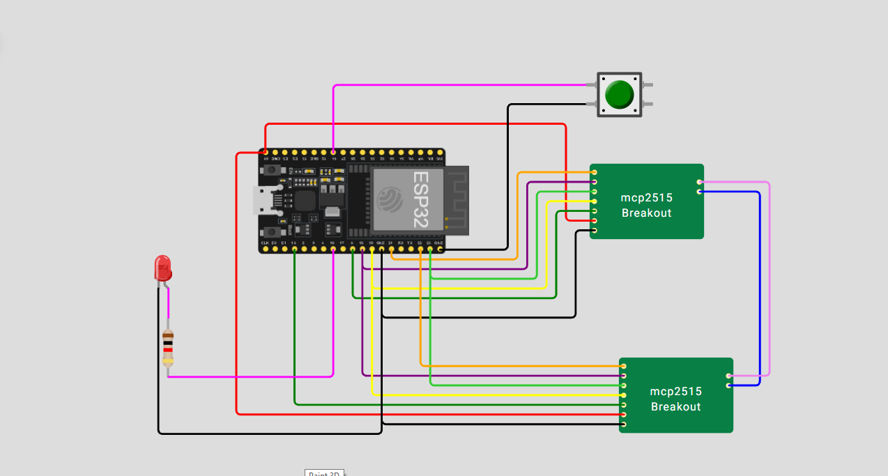

# Automotive CAN Communication Demo

An ESP32-based Controller Area Network (CAN) communication prototype built for the Wokwi simulator. A pushbutton requests a CAN frame from one simulated MCP2515 controller; a second simulated MCP2515 controller receives the frame, and the ESP32 changes the state of an indicator LED when the received identifier and payload match the expected values.

> **Project status: Partial functional verification.** The supplied serial log shows successful initialization messages for both CAN controllers, button-triggered send logic, and reception of a frame reported as CAN ID `0x01`. The supplied circuit screenshot shows the LED illuminated. The logged payload value, the reason for an earlier `0xF0` frame, and repeated LED-toggle behavior have not been fully verified. This project is a simulation prototype, not a validated in-vehicle device.

## 1. Project Overview

This project demonstrates the basic message flow used in automotive embedded communication. An ESP32 runs an Arduino/C++ sketch and communicates with two custom simulated MCP2515 CAN-controller instances over a shared SPI bus. When the user presses the pushbutton, the sketch requests transmission of a standard CAN data frame with identifier `0x01` and one data byte set to `0x01`. The receiver polls for CAN frames; a matching frame is intended to toggle the indicator LED.

The simulation is intended for learning and portfolio demonstration. It does not represent two independent electronic control units (ECUs), and it is not intended to be connected to a real vehicle network.

## 2. Project Objectives

- Demonstrate the fundamentals of CAN-message transmission and reception.
- Use SPI communication to access two CAN-controller instances with separate chip-select signals.
- Read a pushbutton input and initiate a CAN transmission.
- Check a received frame's identifier and first data byte before changing an LED output.
- Practice Arduino/C++ programming, embedded debugging, circuit interpretation, and serial-monitor testing.
- Document test evidence and distinguish observed behavior from behavior that still needs verification.

## 3. Components and Tools

| Component or tool | Role in the project |
|---|---|
| ESP32 DevKit C V4 (Wokwi) | Runs the application, reads the button, accesses both CAN controllers, and controls the LED. |
| Two simulated MCP2515 CAN-controller breakouts | Model the sender and receiver sides of the CAN communication example. |
| Pushbutton | Starts the message-send path; it is active LOW through `INPUT_PULLUP`. |
| Red LED | Indicates a matching received message by changing state. |
| 1 kΩ resistor | Limits the LED current in the displayed circuit. |
| Wokwi | Circuit and embedded-software simulation environment. |
| Arduino C/C++ | Implements controller setup, message sending and receiving, and LED behavior. |
| `SPI.h` | Provides SPI bus support from the ESP32 Arduino core. |
| `mcp_can.h` / `mcp_can` | Provides the MCP2515-compatible CAN-controller API used by the sketch. |
| Custom Wokwi chip files | Describe the emulated MCP2515 components used by the simulation. |

The supplied project includes a simulated controller model; it does not include a validated physical CAN transceiver or vehicle interface.

## 4. System Architecture

```text
                         USB Serial Monitor
                                 |
                         +------------------+
 Pushbutton ------------>|                  |----------> LED + 1 kΩ resistor
 GPIO 14                  |      ESP32       |           GPIO 16
                          |                  |
                          |  Shared SPI bus  |
                          +----+--------+----+
                               |        |
                        CS GPIO 5   CS GPIO 15
                               |        |
                     +---------v+      +v----------+
                     | Simulated|      | Simulated |
                     | MCP2515  |      | MCP2515   |
                     | Sender   |      | Receiver  |
                     +----+-----+      +-----+-----+
                          |                  |
                       CANH ---------------- CANH
                       CANL ---------------- CANL
```

The ESP32 controls both simulated controllers and acts as the application processor. The sender and receiver are separate controller models, but they are not independent microcontroller-based ECUs. The controllers share the ESP32's SPI signals and use separate chip-select pins.

## 5. Circuit Connections

The following table reflects the pin assignments in the supplied `diagram.json` and sketch.

| ESP32 pin or signal | Connects to | Purpose |
|---|---|---|
| `5V` | `VCC` on both simulated MCP2515 modules | Module supply in the Wokwi circuit definition. |
| `GND` | `GND` on both modules and one pushbutton terminal | Common reference and button return path. |
| GPIO 5 | Sender `CS` | Selects the sender over SPI. |
| GPIO 15 | Receiver `CS` | Selects the receiver over SPI. |
| GPIO 18 | `SCK` on both modules | Shared SPI clock. |
| GPIO 23 | `MOSI` on both modules | ESP32 SPI data output. |
| GPIO 19 | `MISO` on both modules | ESP32 SPI data input. |
| GPIO 21 | Sender `INT` | Interrupt line shown in the circuit diagram. The sketch currently polls for received messages rather than handling this interrupt directly. |
| GPIO 22 | Receiver `INT` | Interrupt line shown in the circuit diagram. The sketch currently polls for received messages rather than handling this interrupt directly. |
| GPIO 14 | Pushbutton signal terminal | Button input configured as `INPUT_PULLUP`; pressing the button pulls the pin LOW. |
| GPIO 16 | 1 kΩ resistor, then LED anode | Drives the indicator LED. Connect the LED cathode to GND. |
| Sender `CAN_H` | Receiver `CAN_H` | Connects the simulated CAN-high line. |
| Sender `CAN_L` | Receiver `CAN_L` | Connects the simulated CAN-low line. |

**Physical-hardware caution:** These connections describe the supplied simulation, not a validated hardware wiring plan. Before building a physical version, check each module's supply and logic-voltage requirements and use suitable CAN transceivers. A physical CAN bus also requires correct topology and appropriate termination, typically 120 Ω at each bus end. Do not connect this unvalidated example directly to a vehicle network.

## 6. Software Implementation

The application is in [`src/main.ino`](src/main.ino). Its main operations are:

1. Start the serial monitor at **115200 baud** and configure GPIO 14 as `INPUT_PULLUP` and GPIO 16 as an output.
2. Initialize the sender and receiver `MCP_CAN` objects with a requested bitrate of **125 kbps** and an MCP2515 oscillator setting of **16 MHz**. Each controller uses its own chip-select pin.
3. When GPIO 14 reads LOW, prepare a one-byte payload containing `0x01` and request transmission of a standard CAN data frame with identifier `0x01`.
4. Poll the receiver for a frame. The sketch toggles the LED when the received identifier is `0x01`, the frame length is at least one byte, and the first data byte is `0x01`.
5. Print basic initialization, button, and received-frame diagnostics to the serial monitor.

### CAN message used by the example

| Field | Configured value |
|---|---|
| Frame | Standard CAN data frame |
| Identifier | `0x01` |
| Payload length | 1 byte |
| Data byte 0 | `0x01` |
| Requested bitrate | 125 kbps |
| MCP2515 oscillator setting | 16 MHz |

The archived sketch sends repeatedly while the button remains held, with a 500 ms delay in the send path. Consequently, one long press may result in multiple frames and LED state changes. The code is a learning example and does not implement automotive-grade diagnostics, fault recovery, message authentication, or safety handling.

## 7. Testing and Verification

Testing conclusions below are based on the supplied serial-monitor log (`Code.txt`), circuit screenshot (`After.PNG`), and updated test notes. They describe the available simulation evidence only.

| Test | Observed evidence | Status |
|---|---|---|
| Sender controller initialization | The log shows configuration/baud-rate setup and a sender-initialized message. | **PASS — observed** |
| Receiver controller initialization | The log shows configuration/baud-rate setup and a receiver-initialized message. | **PASS — observed** |
| Button handling | `Button pressed. Sending CAN message...` appears in the serial log. | **PASS — observed** |
| Reception of CAN ID `0x01` | The log reports `Message received! ID: 0x1` after the button event. (`0x1` is the same numeric identifier as `0x01`.) | **PASS — ID observed** |
| Payload byte verification | The supplied log does not print the received data byte. | **NOT VERIFIED** |
| LED output | The supplied `After.PNG` screenshot shows the LED illuminated. | **PASS — ON state observed** |
| Repeated LED toggling | Only one LED state is documented, so repeated ON/OFF transitions are not confirmed. | **NOT VERIFIED** |
| Unexpected earlier frame | The log reports `Message received! ID: 0xF0` before the button-triggered message; its origin and meaning are unknown from the available evidence. | **REVIEW REQUIRED** |

**Overall assessment: Partial functional pass.** The initialization messages, button event, received ID, and illuminated LED are supported by the supplied evidence. The exact received payload, the source of the earlier `0xF0` frame, and repeated LED toggling still need to be checked. The screenshot documents the displayed wiring but does not prove that every connection or signal behaves correctly under all conditions.

For repeatable verification, capture a fresh serial log across startup, several button presses, and releases; log the received payload bytes as well as the CAN ID; investigate the `0xF0` frame; and capture both LED states. Do not describe the prototype as fully validated until these checks are complete.

## 8. How to Run the Simulation

1. Open the [Wokwi project](https://wokwi.com/projects/478978980774950913) referenced by the supplied archive.
2. Confirm that the project contains the ESP32 circuit definition (`diagram.json`), the sketch (`src/main.ino`), `libraries.txt`, and the custom MCP2515 model files (`mcp2515.chip.json` and `mcp2515.chip.c`).
3. Ensure the `mcp_can` library is available in the Wokwi project. The supplied `libraries.txt` also lists `OneWire`, although the current sketch does not use it.
4. Start the simulation and open the Serial Monitor at **115200 baud**.
5. Check for successful sender and receiver initialization messages.
6. Press the pushbutton connected to GPIO 14. Look for the button-send message and a receive message reporting CAN ID `0x01`.
7. Observe the LED connected to GPIO 16. A matching received frame is intended to toggle its state.
8. Compare the actual behavior with the test table in Section 7 and record any differences.

If starting from a new Wokwi project, add the custom chip files using Wokwi's supported custom-chip workflow. The included simulation components are custom models, so behavior can depend on the Wokwi project setup and library/API compatibility. The serial output and LED behavior should be verified in the live project rather than inferred from the circuit image alone.

## 9. Project Structure

```text
Automotive CAN Communication Demo/
└── embedded-sensor-monitoring-system/
    ├── README.md
    ├── src/
    │   └── main.ino
    ├── docs/
    │   ├── wiring-diagram.png
    │   ├── test-results.md
    │   └── system-description.md
    ├── media/
    │   ├── circuit.png
    │   └── demo.gif
    ├── diagram.json
    ├── libraries.txt
    ├── mcp2515.chip.c
    ├── mcp2515.chip.json
    └── wokwi-project.txt
```

The folder name `embedded-sensor-monitoring-system` is retained from the supplied archive structure, although this repository demonstrates CAN communication rather than sensor monitoring.

## 10. Skills Demonstrated

- Embedded C/C++ programming with the Arduino framework.
- ESP32 GPIO configuration and pushbutton input handling.
- SPI bus concepts and multi-device chip-select management.
- CAN frame concepts, identifiers, payload length, and controller configuration.
- Basic message filtering and output-state control.
- Serial-monitor debugging and evidence-based functional testing.
- Reading and documenting a simulated circuit and its pin assignments.
- Organizing source code, technical documentation, simulation assets, and test notes for a GitHub portfolio.

## 11. Limitations and Future Improvements

### Current limitations

- Both CAN controllers are simulated components controlled by one ESP32; they are not two independent ECUs.
- The custom MCP2515 model is not proof of physical MCP2515 or automotive-network conformance.
- The supplied log does not confirm the transmitted or received payload byte, and the origin of the early `0xF0` frame remains unclear.
- LED ON/OFF transitions across repeated frames have not both been documented.
- The archived sketch transmits repeatedly while the button remains pressed, uses a fixed delay, and has limited error reporting.
- The project does not implement OBD-II diagnostics, UDS, AUTOSAR, an OEM-specific CAN database, or vehicle-grade safety/security behavior.

### Possible future improvements

- Add a transmission result check and log the complete CAN identifier, DLC, and payload bytes on both sender and receiver sides.
- Replace the delay-based button handling with debouncing and one-frame-per-press edge detection.
- Investigate and explain the unexpected `0xF0` frame and add receive counters or timeout diagnostics.
- Capture repeatable screenshots or a genuine live simulation recording showing both LED states.
- Add a second independent MCU/ECU node where the simulator supports it, or validate with two physical nodes on a safe bench setup.
- Extend the example with clearly documented simulated vehicle data and message definitions.
- For hardware work, select compatible CAN transceivers, verify voltage levels, add appropriate bus termination, and validate on a current-limited bench before any vehicle integration.

## 12. Demonstration

- **Wokwi simulation:** [Open the Automotive CAN Communication Demo](https://wokwi.com/projects/478978980774950913)
- **Circuit diagram:** [`docs/wiring-diagram.png`](docs/wiring-diagram.png)
- **Circuit image:** [`media/circuit.png`](media/circuit.png)
- **Illustrated walkthrough:** [`media/demo.gif`](media/demo.gif)

The included GIF is an annotated walkthrough made from still images; it is not a live recording of the simulation. Use the Wokwi project to observe runtime behavior, and treat the test results above as the current documented evidence.



## 13. Author

**Ahmed Abbas**  
Mechatronics Engineering | Embedded Systems | Automotive Engineering

- **GitHub:** [https://github.com/abbasahmed494-coder](https://github.com/abbasahmed494-coder)
- **LinkedIn:** [https://www.linkedin.com/in/ahmed-abbas-7a7b04221/](https://www.linkedin.com/in/ahmed-abbas-7a7b04221/)
